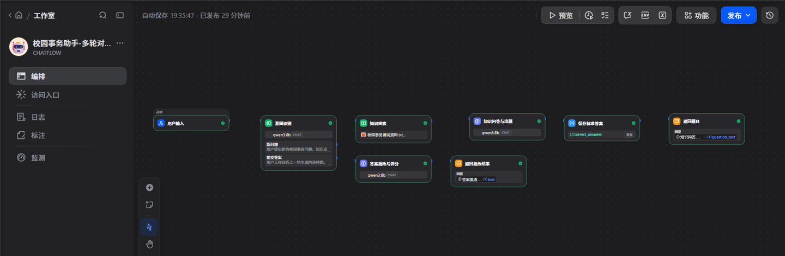
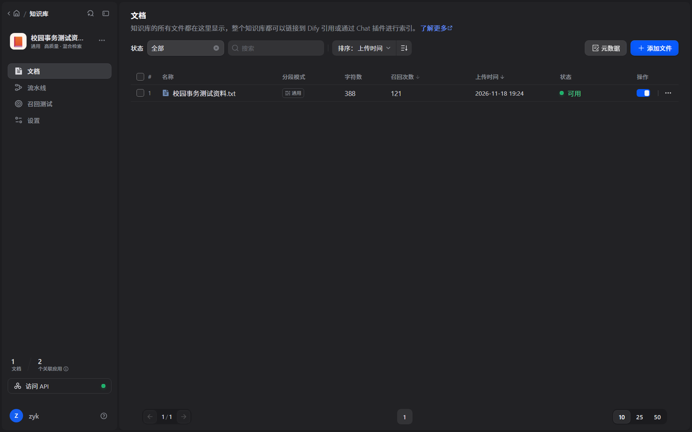
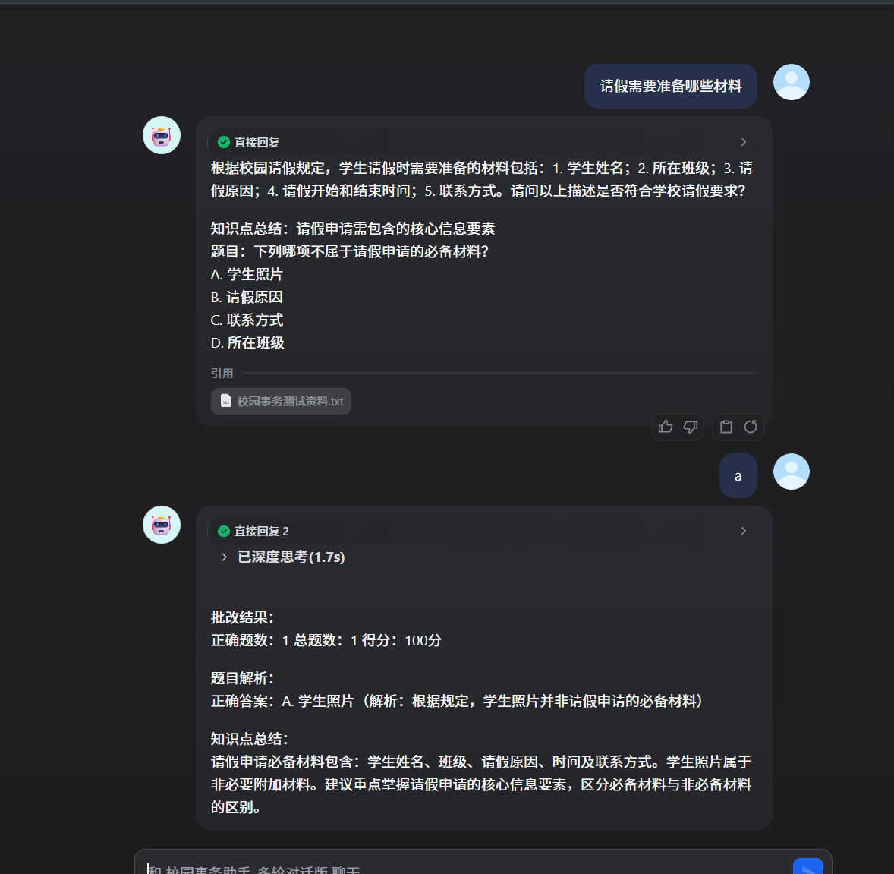
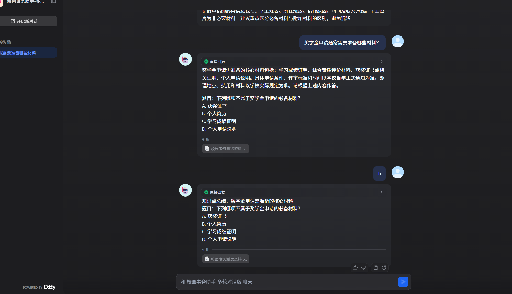
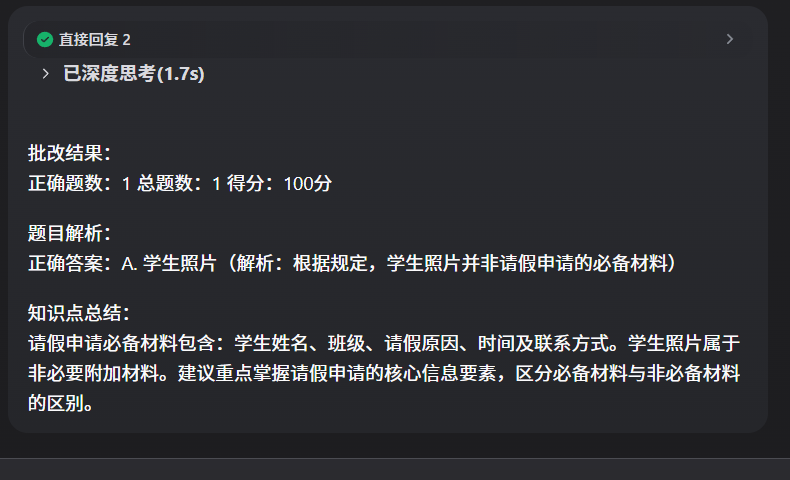
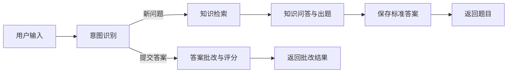

# 校园事务 AI 智能学习助手

基于 **Dify Chatflow + 本地 Ollama 模型** 搭建的校园事务问答与学习练习助手。用户提问校园事务（请假、奖学金、学生证补办等），系统从知识库检索作答，并自动生成选择题；用户提交答案后，系统批改、评分并给出解析。

> 项目定位：RAG 知识库问答 + 多轮练习闭环的个人作品，用于展示 Dify 工作流编排、本地大模型部署与 RAG 检索能力。
>
> 说明：知识库内容为**模拟测试资料**，不代表任何真实学校的官方规定。

---

## 一、项目简介

很多校园事务信息分散在通知、群消息和辅导员口中，学生查询成本高；同时"看完就忘"是常见问题。本项目把两件事合在一起：

1. **查得到**：用 RAG 从知识库中检索相关片段，让回答有依据、可溯源（展示引用来源）。
2. **记得住**：基于检索到的内容自动出选择题，提交答案后自动批改、评分并给出解析。

系统对知识库没有覆盖的问题会明确提示"请咨询相关部门"，避免模型凭空编造。

## 二、核心功能

| 功能 | 说明 |
|---|---|
| 知识库问答 | 根据校园事务知识库回答问题，回答附带检索引用 |
| RAG 检索 | 检索知识库片段作为回答依据 |
| 知识点总结 | 从检索到的资料中提炼重点 |
| 自动生成题目 | 根据知识库内容生成选择题 |
| 保存标准答案 | 用会话变量保存本题标准答案，供后续批改使用 |
| 答案批改 | 用户提交答案后自动判断正误 |
| 评分与解析 | 计算得分，并逐题给出正确答案与解析 |
| 知识边界控制 | 知识库未涉及的问题提示咨询相关部门，不编造内容 |

## 三、效果展示

### 1. Chatflow 工作流



### 2. 知识库（高中质量索引 + 混合检索）



### 3. 知识库问答 + 出题（请假场景）



### 4. 知识库问答 + 引用展示（奖学金场景）



### 5. 提交答案后的批改、评分与解析



## 四、工作流设计

项目在 Dify 中用 Chatflow 搭建，由「意图识别」节点把用户输入分流到两个分支：



- **新问题分支**：知识检索 → 知识问答与出题 → 保存标准答案 → 返回题目。
- **答案提交分支**：答案批改与评分 → 返回批改结果。
- 标准答案通过**会话变量**保存，因此可以在后续轮次中完成批改，实现多轮练习。
- 检索节点直接引用知识库，回答中通过「引用」区域展示命中的文档片段。

## 五、技术栈

| 技术 | 用途 |
|---|---|
| Dify | Chatflow 工作流编排、知识库与变量管理 |
| Ollama | 本地模型运行环境 |
| Qwen3:8b | 意图识别、问答、出题与答案批改 |
| BGE-M3 | 文本向量化与知识检索 |
| RAG | 基于知识库的检索增强生成 |
| Docker | 本地部署运行环境 |

## 六、目录结构

```
校园事务AI智能学习助手/
├── README.md                    项目说明（本文件）
├── .gitignore                   版本控制忽略规则
├── docs/
│   ├── 01-项目结构说明.md        每个目录/文件的用途
│   ├── 02-工作流设计.md          节点职责与分支逻辑
│   ├── 03-部署与运行.md          本地环境搭建与启动步骤
│   └── 04-测试记录.md            已完成的测试场景与结果
├── screenshots/                 项目截图（工作流、问答、出题、批改）
└── knowledge_base/
    └── 校园事务测试资料.txt      知识库示例文档（模拟资料）
```

## 七、本地运行

前置条件：Docker、Ollama，并已拉取 `qwen3:8b` 与 `bge-m3` 两个模型。

```bash
# 1. 拉取模型
ollama pull qwen3:8b
ollama pull bge-m3

# 2. 启动 Dify（在 dify 的 docker 目录下）
docker compose up -d
```

启动后在 Dify 中：

1. 将 `knowledge_base/校园事务测试资料.txt` 上传为知识库，嵌入模型选择 BGE-M3。
2. 在模型供应商中接入 Ollama，对话模型选择 `qwen3:8b`。
3. 按第四节的结构搭建 Chatflow，节点命名与分支保持一致。

更详细的步骤见 [docs/03-部署与运行.md](docs/03-部署与运行.md)。

## 八、测试情况

已完成的真实验证场景（详见 [docs/04-测试记录.md](docs/04-测试记录.md)）：

1. 请假申请场景：正确检索知识库并回答，同时生成选择题。
2. 奖学金申请场景：提取申请材料等知识点并生成选择题，展示引用来源。
3. 答案批改：提交答案后判断正误、计算得分（示例中 1/1 题，100 分）并给出解析。
4. 知识库外问题：对食堂开放时间等未收录内容提示咨询相关部门，不编造信息。
5. 引用展示：回答下方正常展示命中的知识库文档。

## 九、项目亮点

- 用可视化工作流把「检索 → 出题 → 存答案 → 批改」串成一个完整闭环，而不是单轮问答。
- 借助会话变量跨轮保存状态，实现"答题—批改—解析"的多轮交互。
- 通过知识库约束回答范围，并对超出范围的问题做边界处理，降低幻觉风险。
- 全流程使用本地模型（Qwen3:8b + BGE-M3），不依赖云端 API。

## 十、后续计划

- 扩充知识库覆盖范围（更多校园事务条目、真实通知格式）。
- 增加多题连续练习与错题回顾。
- 优化批改提示词，支持多选、填空等题型。

---

### 免责声明

本项目的知识库内容仅用于学习与演示，为模拟资料；实际校园事务请以学校官方规定和辅导员通知为准。
