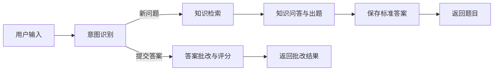

# 工作流设计

本项目是一个 Dify **Chatflow**，核心思路：先用意图识别把输入分成"提新问题"和"交答案"两类，再分别走两条分支。

## 整体结构

## 节点职责

| 节点 | 类型 | 作用 |
|---|---|---|
| 用户输入 | 开始节点 | 接收用户输入的 `query` |
| 意图识别 | 问题分类器（qwen3:8b） | 判断这次输入是"新问题"还是"提交答案" |
| 知识检索 | 知识检索节点 | 从知识库 `校园事务测试资料.txt` 中检索相关片段 |
| 知识问答与出题 | LLM（qwen3:8b） | 基于检索内容回答提问，并生成选择题 |
| 保存标准答案 | 变量赋值节点 | 把本题标准答案写入会话变量 `correct_answers` |
| 返回题目 | 直接回复 | 把回答 + 题目返回给用户 |
| 答案批改与评分 | LLM（qwen3:8b） | 读取用户答案与会话变量中的标准答案，判断正误、算分、写解析 |
| 返回批改结果 | 直接回复 | 返回批改结果 |

## 两个分支的关键点

### 1. 新问题分支

1. 用户问「请假需要准备哪些材料」这类问题；
2. 意图识别判定为"新问题"，进入知识检索；
3. 检索命中的片段作为上下文交给 LLM，生成回答、知识点总结和题目；
4. 同时把标准答案存入会话变量，为下一步批改做准备；
5. 通过「引用」区域展示命中的知识库文档，让回答可溯源。

### 2. 答案提交分支

1. 用户只输入「a」「b」这类选项字母；
2. 意图识别判定为"提交答案"，进入批改节点；
3. 批改节点对比标准答案，输出正确题数、总分和逐题解析；
4. 返回批改结果，可继续出下一题。

## 为什么要用会话变量

Chatflow 的每个节点是独立执行的，批改节点无法"看到"出题节点的内部结果。把标准答案写进会话变量，等于给多轮对话留了一块共享内存，才能在下一轮完成批改。

## 边界控制怎么做

知识库只收录了请假、奖学金、学生证补办三类事务。当用户问到知识库没有的内容（例如食堂开放时间），检索不到有效片段，出题/回答节点的提示词约束模型不要编造，改为提示用户咨询学校相关部门。

## 修改提示词时的注意点

- 出题节点的输出格式要和批改节点约定一致（题目、选项、标准答案三部分齐全），否则批改会拿不到答案。
- 变量赋值节点写入的变量名，必须和批改节点引用的变量名完全相同。
- 调整知识库分段规则后，建议重新跑一遍请假与奖学金两个场景，确认检索命中正常。
